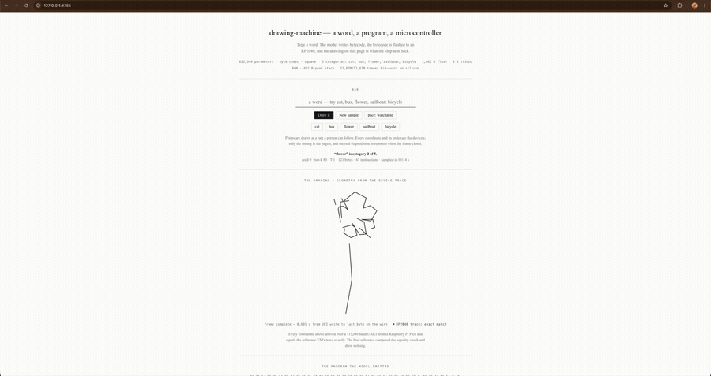
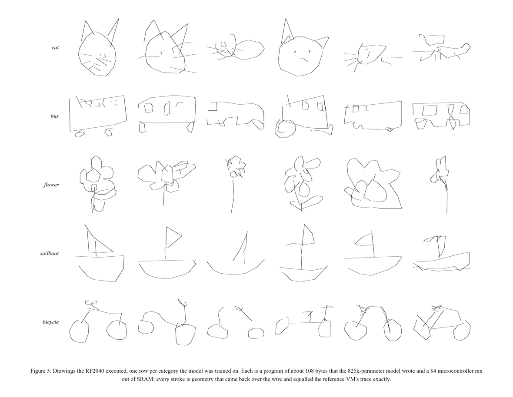

# drawing-machine

Can a small transformer learn to draw by writing a program? I trained models with fewer than a million parameters to emit instructions for a pen: move here, draw a line, repeat a shape. A Raspberry Pi Pico executes the finished program and sends the points back. The model runs on the host. The strokes you see in the hardware demo come from the board.

[Open the gallery offline](https://github.com/roodriigoooo/drawing-machine/releases/download/v0.2.0/gallery.html) · [Read the results](docs/hypothesis_and_results.md) · [Run the demo](docs/demo.md)



## What changes when a drawing is a program?

**The alphabet matters, and the answer depends on the drawings.** On synthetic programs, replacing bytes with bits changed the cost by −0.67 ± 0.77 bits per drawing. On human QuickDraw sketches, it cost an extra 11.58 ± 0.60. Both encodings describe exactly the same geometry. Both 95% intervals pair the same drawings across encodings. The synthetic interval also includes variation between two seeds. QuickDraw had one paired seed.



*Each comparison subtracts the byte model's score from the bit model's. Above zero, the byte model predicts the drawing more economically.*

**Recognising a pattern was easier than finishing it.** Models assigned more probability to continuations that agreed with earlier strokes. When sampling freely, they completed the exact compatible shape in roughly 1% of the tested composed-shape cases. I then gave a model an explicit COPY action and showed it a shape before and after an affine transform. In two seeds it scored 0/64 exact on each held-out panel. Supplying the correct action gave 64/64. Whether COPY helps once a model learns the transform remains open. [Experimental conditions and figures](docs/hypothesis_and_results.md)

**The programs travel well.** The Pico interpreter takes 1,862 bytes of code and read-only data, zero static RAM, and 492 bytes of peak stack. Across 12,670 programs its traces matched the Python reference exactly. Those figures describe the interpreter. The complete demo also needs program storage, transport and host inference.



*Cat, bus, flower, sailboat and bicycle are the five trained categories. Each example above was reconstructed from a saved board trace.*

## Draw something

To watch the 60 recorded drawings, download [gallery.html](https://github.com/roodriigoooo/drawing-machine/releases/download/v0.2.0/gallery.html) and open it in a browser. Twenty captures start with strokes from a held-out human sketch.

To generate a new drawing, use Python 3.11 or later, `make` and a C compiler. Start with the tagged release:

```sh
git clone --branch v0.2.0 --depth 1 https://github.com/roodriigoooo/drawing-machine.git
cd drawing-machine
python3 -m venv .venv
source .venv/bin/activate
python -m pip install -e '.[demo]'
python scripts/demo.py --native live
```

Open the local URL printed in the terminal and try `cat`. The included 825,344-parameter checkpoint writes the program and the native C interpreter executes it. The first request for each word uses seed 0. Choose **New sample** to see another drawing. The [demo guide](docs/demo.md) covers the physical Pico, the seed-0 check and how to read the figures.

Original code is [MIT licensed](LICENSE). Quick, Draw! contributors supplied the human sketches. Dataset and icon credits are in the [third-party notices](THIRD_PARTY_NOTICES.md).
