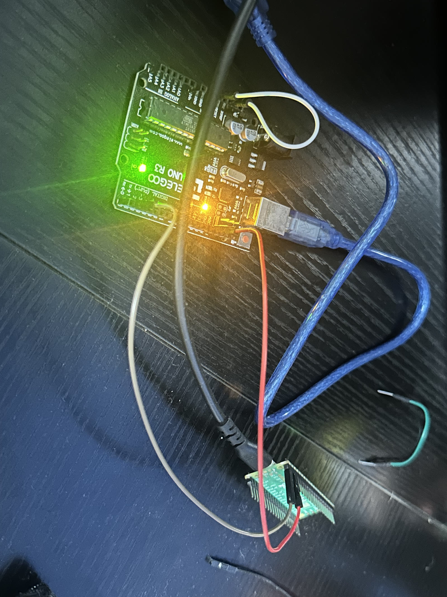

# Drawing a cat, from seed to strokes

The same model writes bytecode in both live modes. In native mode the computer runs the C interpreter. In Pico mode the host sends the program to the board and reads back fixed-point geometry over UART. Each capture records which interpreter produced it.

## Replay a drawing

Download [the offline gallery](https://github.com/roodriigoooo/drawing-machine/releases/download/v0.2.0/gallery.html) and open it locally. To rebuild it from the published captures, install the demo dependencies as shown in the [README](../README.md), then run:

```sh
python scripts/demo.py gallery --silicon-only
```

Open `artifacts/demo/gallery.html`. The 60 [capture records](../artifacts/demo/records) include the program and returned geometry. Twenty also include a held-out human prefix. The [publication manifest](../artifacts/demo/publication.json) identifies the original and published captures.

## Generate a drawing

```sh
python scripts/demo.py --native live
```

Open the printed URL and choose a category. The first drawing for each word uses seed 0. **New sample** advances that word's seed by one. The sampler uses temperature 1 and top-k 80. The checkpoint and its matching run record are in `runs/`. The five categories come from that record. A few synonyms are accepted.

For a check without a browser, run:

```sh
python scripts/demo.py --native capture --words cat --repeat 1
```

With the release checkpoint and the verified CPU environment (tested with PyTorch 2.13.0 and 2.15.0 on macOS ARM64), seed 0 yields a 121-byte program. Compare its `sampled.bytecode_hex` with the [saved Pico cat](../artifacts/demo/records/rp2040_cat_988146777b.json). The native capture should say `source: "native"` and `device.matches_reference: true`. Sampling can vary across PyTorch versions. The C and Python interpreters should agree for the same bytes.

If Apple clang reports an unsupported architecture inside an SDK stub while building the native interpreter, select a compatible installed SDK. On the release machine, setting `SDKROOT=/Library/Developer/CommandLineTools/SDKs/MacOSX15.5.sdk` for the command resolved it.

## Run it on the original Pico

The published hardware path uses macOS, clang, LLVM's `ld.lld`, an RP2040 Pico and a 3.3 V USB serial receiver. Connect GP0 (Pico TX) to the receiver's RX and connect their grounds. Power the Pico through its own USB cable. Hold BOOTSEL while plugging it in for the first drawing.

```sh
python scripts/pico.py --ports
python scripts/demo.py live
```

The host loads a RAM image through the mounted BOOTSEL drive. After a drawing the board returns to BOOTSEL for the next request. The page checks the trace against the reference VM and refuses a mismatched or incomplete frame.



## Read the pictures

| Figure | What to look for |
|---|---|
| [Gallery](media/gallery.png) | Black strokes are selected board traces. The category label is the input to the model. |
| [Neighbours](media/novelty.png) | Grey drawings are the nearest matches in a sampled training bank. They give a visual comparison with familiar shapes. |
| [Continuations](media/prefix.png) | Red strokes are the supplied human prefix. The model produced the extension. |
| [Program](media/program.png) | The bytecode alongside the picture shows which instruction produced each piece of geometry. |

The Pico currently executes completed programs. A prospective 8-bit export would use about 806 KiB of flash for weights. With four layers of width 128, separately quantised 8-bit keys and values would use another 1 KiB of SRAM per cached position. The original Pico has 2 MiB flash and 264 KiB SRAM. These are sizing estimates for a possible inference port. Tim's Pico-Faces runs a different model on the newer RP2350. [Pico specifications](https://www.raspberrypi.com/products/raspberry-pi-pico/) · [Pico-Faces](https://cpldcpu.github.io/2026/08/28/ai-image-generation-on-a-rp-pico-2-microcontroller/)

In a host check with the released weights, limiting attention to 192 positions added 0.015 bits per drawing across the 1,000 validation drawings. Only 20 reached beyond the window. On those 20, the mean cost was 0.75 bits. This measures next-byte predictions in float32 with the correct prefix supplied. To repeat the check, run `PYTHONPATH=. python artifacts/window/score.py` from the checkout. The loader downloads the five QuickDraw categories on first use. [Window scores](../artifacts/window/readout.json)
