# What does a small model learn about drawing?

The output in these experiments is an executable program. An opcode describes a pen action and its operand bytes describe positions, widths or counts. The same program can be written as tokens, bytes or bits and decoded back to exactly the same geometry. This lets us change what the model sees while holding the drawing fixed.

## 1. Change the alphabet

The decoder is a causal transformer with rotary positions, RMSNorm, SwiGLU and tied input and output embeddings. The main comparison uses four layers of width 128. Weight tying matters at this size because the vocabulary competes with the rest of the model for parameters.

I scored each held-out program under both encodings and subtracted the byte score from the bit score. Scores are negative log probabilities converted to **bits per complete drawing**. A unit like bits per token would change meaning between alphabets. Reported 95% intervals use paired validation drawings and include a between-seed term where replication is available. The one-seed QuickDraw comparison measures within-seed uncertainty.

| Corpus, 24,000 training steps | Bit minus byte | Seeds | Reading |
|---|---:|---:|---|
| Synthetic programs | −0.67 ± 0.77 bits/drawing | 2 | Both seeds slightly favoured bits. The interval includes zero. |
| Five QuickDraw categories | +11.58 ± 0.60 bits/drawing | 1 paired seed | Splitting bytes into bits made human drawings more costly to predict. |

*The zero line marks equal predictive cost. The comparison reverses between the two corpora.*

One byte also takes eight prediction steps in the bit model. In the synthetic budget sweep, the bit arm processed about 254 million training tokens against 32 million for bytes. Giving the models equal steps and giving them equal tokens answer different questions. [Budget comparison](figs/fig2_budget.svg)

The other comparisons isolate three choices: flagging opcodes, giving operand types their own vocabulary entries and expressing coordinates relative to the pen. For the wide synthetic model, fusing operand type and value cost 4.87 ± 2.18 bits per drawing. Relative coordinates have a different benefit: translating a whole motif changes its starting coordinate pair while leaving subsequent displacements intact. [Example spellings of one program](figs/spellings_drawn.svg)

## 2. Find structure in a flat sequence

Models trained on repeated motifs saw the individual drawing instructions. Later copies became cheaper to predict. Relative to the measured opportunity for compression, recovery reached 0.807 and 0.784 in two seeds. At the fifth copy, just beyond the trained count of four, surprise rose in both seeds. They disagreed on the size of that rise. The measurement concerns predictability of a repetition. It does not show the model emitting a loop instruction. [Recovery by copy number](figs/fig3_recovery.svg)

When the language was extended to include rotations, reflections and translations, an explicit loop could fold 40.9% of the corpus bytes. Direct savings in predictive cost were much smaller because the flat model already found later copies predictable. The shorter spelling also improved generated length control. [Transform recovery](figs/fig9_transform_recovery.svg) · [Cost of folding a motif](figs/fig10_fold_price.svg)

## 3. Plan strokes, then draw them

I compared a flat decoder with a two-level model that first plans stroke summaries and then fills in the bytes. At matched budget the tested hierarchical models used roughly 40 to 50 additional bits per drawing. Their sampled lengths tracked the data better. Autoregressive and diffusion planners showed similar termination benefits on the same summary grid. Choosing a winner by likelihood alone would miss the most visible difference between their drawings. [Samples from the hierarchical model](figs/quickdraw_plannerar24000eps2_byte_balanced_s0_s0.svg)

Conditioning a single model on five QuickDraw classes gave us the demo. Scoring each validation drawing under all five labels recovered the original class with 99.1% and 99.3% accuracy across two seeds. That's a test of class information in the likelihood. For generated shapes, the matching class was the nearest real-class distribution in 48 of 50 comparisons. [Class likelihoods](figs/fig13_conditioning.svg) · [Generated geometry](figs/fig14_class_geometry.svg)

## 4. Recognise a relation and try to finish it

I first tested whether tracking execution state could rule out unlikely next symbols. On the structured transform corpus, the dynamic information saved only 0.0022 and 0.0077 bits per drawing in two seeds, below the prespecified 0.01 threshold. Simple grammar constraints did improve validity on a weak flat model. That made it useful to distinguish a legal continuation from one that actually matches the geometry.

Changing a relevant part of a prefix shifted model preference toward the compatible continuation. Controls changed unrelated parts of the drawing. Yet when asked to generate freely, the models finished an exactly compatible shape in roughly 1% of the tested composed-shape cases.

*Scoring a supplied continuation and producing its coordinates are different tests. The gap between them motivated the COPY experiment.*

I also tested feeding top-layer states back into later predictions. At the tested scale the gated-feedback implementation failed its prespecified stability checks, so the relation evaluation stopped there. [Feedback calibration](figs/fig16_feedback_calibration.svg)

### Demonstrated affine COPY pilot

The prompt gives a motif A, a transformed example T(A) and a second motif B. The target is T(B). A byte baseline emits ordinary instructions. The relation model can also select an earlier span and apply a transform. Each pilot model trained for 1,024 updates.

| Exact blocks | Seed A | Seed B |
|---|---:|---:|
| Small fit, learned COPY | 16/16 | 16/16 |
| Larger pilot, learned COPY on the training panel | 0/16 | 0/16 |
| Learned generation on each held-out panel, either model | 0/64 | 0/64 |
| Correct action supplied on each held-out panel | 64/64 | 64/64 |

*In the small fit, each first motif identified one transform. In the pilot, the same first motif could have eight transforms. The fit could succeed by lookup, while pilot transform scores stayed near the predictor that ignored the demonstration.*

The three held-out panels tested new examples, transform combinations and source families. Supplying the action produced all 384 target blocks across panels and seeds. The learned models missed every one. The pilot closed as `mixed_or_inconclusive`. It leaves open whether COPY helps once a model can infer the demonstrated transform. [Per-seed readout](../artifacts/relation/demonstrated-affine-20260924.json) · [Frozen pilot source](https://github.com/roodriigoooo/drawing-machine/blob/0df75115509046ee4f423e99a02e29faeca54725/dm/relation/demonstrated_run.py) · [Run design, raw readouts and optimizer updates](https://github.com/roodriigoooo/drawing-machine/releases/download/v0.2.0/pilot-evidence.zip)

## 5. Execute the program on silicon

The C interpreter samples Bézier curves at a power-of-two subdivision. Scaling coordinates by the cube of that subdivision makes the sampled points exact integers. The interpreter streams them as it runs. A reference interpreter on the host checks the returned geometry.

| Measurement | Result | Scope |
|---|---:|---|
| Traces matching the reference | 12,670 / 12,670 | RP2040 conformance sweep |
| Interpreter code and read-only data | 1,862 bytes | Compiled VM, excluding transport and input |
| Static RAM and peak stack | 0 and 492 bytes | Interpreter working memory |
| QuickDraw execution | 7,334 cycles/drawing, 0.611 ms at 12 MHz | VM executing from SRAM |
| Timed programs | 120 | Preserved timing record |

Energy per drawing was not measured. The host generates the program in the live demo. For the measurements and the path from bytecode to a visible stroke, see the [timing rows](../artifacts/silicon/pico_cycles.json), [device cost figure](figs/fig7_device_cost.svg) and [demo guide](demo.md).

## Sources

[Sketch-RNN](https://arxiv.org/abs/1704.03477) supplied the stroke representation used by the QuickDraw loader. [Graphics program induction](https://arxiv.org/abs/1707.09627) motivated the distinction between an execution trace and the program that describes it. [DeepSVG](https://arxiv.org/abs/2007.11301) and [IconShop](https://arxiv.org/abs/2304.14400) provide context for the hierarchy and vocabulary comparisons. Dataset sources and attribution are in the [third-party notices](../THIRD_PARTY_NOTICES.md).
